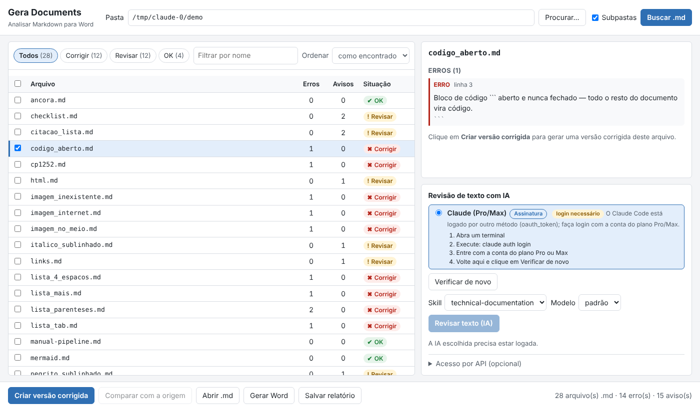
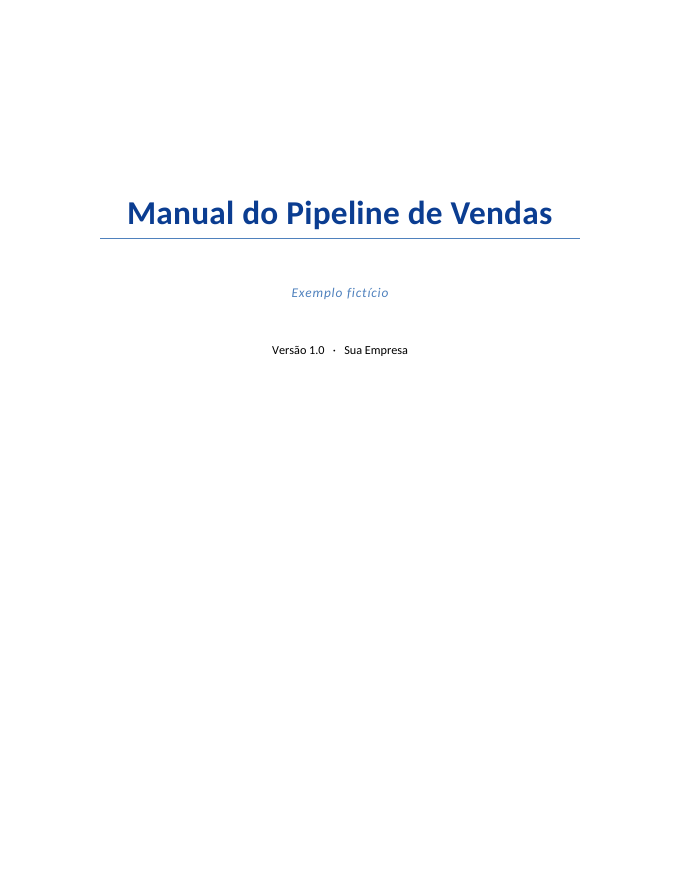
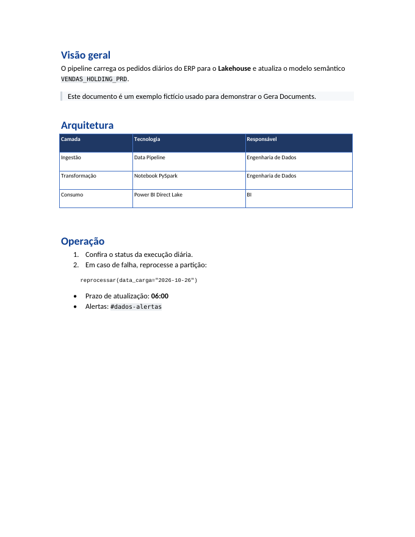
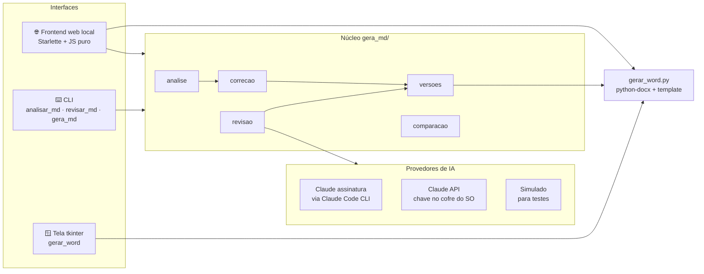

<div align="center">

# 📄 Gera Documents

**Documentação técnica escrita em Markdown, entregue como Word corporativo, com revisão de texto por IA**

[](https://github.com/gilbertosales/gera-documents/actions/workflows/ci.yml)


</div>

---

## 🎯 O problema

Em projetos de dados, a documentação nasce em Markdown, junto do código, mas o cliente quer receber um **Word com capa, sumário, cabeçalho e rodapé da empresa**. Converter na mão é lento, e ferramentas genéricas quebram tabelas largas, listas aninhadas e blocos de código.

O **Gera Documents** resolve o ciclo inteiro:

1. **Analisa** uma pasta de `.md` e aponta, linha a linha, o que vai sair quebrado no Word.
2. **Corrige** automaticamente o que dá (gerando `_v2`, sem tocar no original).
3. **Revisa o texto com IA**, usando a assinatura Claude Pro/Max já logada na máquina, sem chave de API.
4. **Gera o `.docx`** a partir de um template `.dotx`/`.docx` corporativo.

<div align="center">

</div>

## ✨ Funcionalidades

| | |
|---|---|
| 🔎 **Análise** | 20+ regras alinhadas ao conversor: bloco de código sem fechamento, imagem inexistente, tabela sem separador, listas com tab ou 4 espaços, títulos nível 6, HTML, links e riscado que viram texto literal, arquivos em CP-1252 |
| 🛠️ **Correção automática** | Cria a próxima versão livre (`nome_v2.md`, `_v3`...) e lista o que ainda exige ajuste manual. **O original nunca é alterado.** |
| 🤖 **Revisão com IA** | Usa skills do Claude Code (`technical-documentation`). Código, imagens e âncoras viram marcadores protegidos antes do envio, e trechos com resposta suspeita são mantidos e reportados como "não revisados" |
| 🔀 **Comparação** | Diff lado a lado entre o original e cada versão, na tela ou pela linha de comando |
| 📝 **Word corporativo** | Capa, sumário (campo TOC real), estilos do template, listas com numeração nativa, tabelas largas em página paisagem e citações com fundo |
| 🔒 **Local-first** | Servidor só em `127.0.0.1`, token de sessão, proteção contra DNS rebinding e CSRF. Nenhum documento sai da máquina, exceto o texto enviado para revisão |

## 🖼️ Resultado

O Markdown de [`exemplos/manual-pipeline.md`](exemplos/manual-pipeline.md) vira [`manual-pipeline.docx`](exemplos/manual-pipeline.docx):

<div align="center">

&nbsp;&nbsp;

</div>

## 🏗️ Arquitetura



A constituição do projeto ([`.specify/memory/constitution.md`](.specify/memory/constitution.md)) define os princípios que guiaram o desenvolvimento, e a especificação completa do frontend está em [`specs/001-local-web-frontend/`](specs/001-local-web-frontend/). Tudo foi feito com **Spec-Driven Development** (Spec Kit + Claude Code): especificação, plano e tarefas antes do código.

## 🚀 Como usar

```bash
pip install -r requirements.txt

# Frontend web (abre o navegador)
python -m gera_md.web

# Linha de comando
python analisar_md.py ./docs --relatorio --v2     # analisa e cria as versões corrigidas
python revisar_md.py ./docs/manual.md              # revisão com IA
python gerar_word.py ./docs/manual_v2.md           # gera o Word
python -m gera_md comparar manual.md manual_v2.md  # diff
```

No Windows, dois cliques em `Gera Documents.cmd`.

**Template próprio:** aponte para o seu `.dotx` na tela de geração. Os estilos são escolhidos pelo nome (`Title`, `Heading 1`...) com fallback, então templates diferentes funcionam sem alterar código. O modelo neutro em `modelos/modelo_exemplo.docx` serve de ponto de partida.

## 🧪 Testes

```bash
pip install -r requirements-dev.txt
python -m pytest tests -q     # 107 testes: unitários, integração web, CLI e golden snapshots
```

O CI roda no **Ubuntu e no Windows**. Os testes *golden* garantem que a análise continua produzindo exatamente o mesmo resultado depois de cada refatoração.

---

<div align="center">
Feito por <a href="https://github.com/gilbertosales">Gilberto Sales</a> · <a href="https://www.linkedin.com/in/gilberto-gomes-de-sales-3a979651">LinkedIn</a>
</div>
